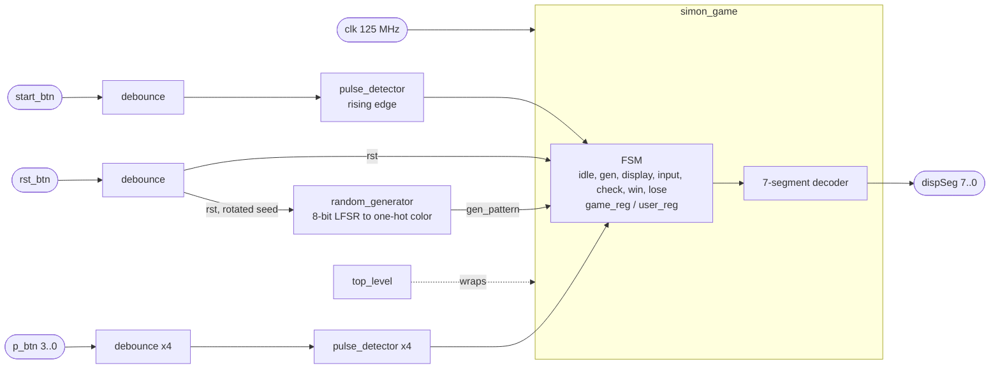

# Embedded Simon Says (Digilent ZYBO)

[](https://github.com/ks1686/Embedded-Simon-Says/actions/workflows/sim.yml)

VHDL Simon Says game, built in Xilinx Vivado as an Embedded Systems final project for the original Digilent **ZYBO (Zynq-7010, Rev B)**. The design is pure programmable logic; the Zynq processor is unused. A 7-segment PMOD flashes the sequence one color at a time as the digits `1` to `4`. While it waits for input, all segments light. You repeat the sequence on four PMOD buttons, and the display shows `n` on a win (then the next, longer round) or `L` on a loss.

`Zybo_Master.xdc` is Digilent's ZYBO Rev B master file (clock on `L16`). It does not fit the newer Zybo Z7, whose clock is on `K17` and BTN0 on `K18`.

## Design



- `top_level.vhd` wraps `simon_game.vhd` and passes the generics through.
- `simon_game.vhd` holds the FSM. Each round, `gen` appends one LFSR color, `display` shows the sequence (half a second on, half off per step), `input` records one press per step, and `check` compares the two. A win at `max_pattern` steps returns to idle.
- `debounce.vhd` needs the input to stay high for `debounce_ticks` cycles. `pulse_detector.vhd` turns a level into a one-cycle edge. `random_generator.vhd` is the LFSR.

Course deliverables are kept as submitted: `Final Report.pdf`, `Final Presentation.pptx`, the Vivado screenshots under `Elaborated Designs/`, `Synthesis Schematics/`, `Simulations/` and `Utilization and Power/`, plus the `block_diagram` and `operation_theory` drawings. They reflect the 2024 design and predate the 2026 RTL hardening.

## Hardware

| Port | Board pin | Role |
| --- | --- | --- |
| `clk` | `L16` (125 MHz) | System clock |
| `start_btn` | BTN0 `R18` | Start a game (rising edge after debounce) |
| `rst_btn` | BTN1 `P16` | Synchronous reset; rotates the LFSR seed once per press |
| `p_btn[0..3]` | JB `T20 U20 V20 W20` | Color buttons 1 to 4 |
| `dispSeg[7:0]` | JD + JE | 7-segment + DP (`1` = segment on) |

Constraints: `Zybo_Master.xdc`. Rebuild the bitstream in Vivado; do not commit `*.bit`.

RTL generics (defaults match the board):

- `clk_freq`: ticks per display / win / lose second (125_000_000)
- `debounce_ticks`: stable samples before a press counts (2_500_000 ≈ 20 ms)
- `max_pattern`: longest sequence (15)

Testbenches override these to tiny counts so a full win/lose path finishes in microseconds.

## Simulate

Needs [nvc](https://www.nickg.me.uk/nvc/) 1.16+ (`brew install nvc`) and, for the cross-check, [GHDL](https://github.com/ghdl/ghdl) (`brew install ghdl`):

```bash
bash scripts/sim.sh            # nvc (default)
SIM=ghdl bash scripts/sim.sh   # GHDL cross-check
SIM=all bash scripts/sim.sh    # both
```

That analyzes RTL + `Test/*_tb.vhd` and runs `debounce_tb`, `pulse_detector_tb`, `random_generator_tb`, `simon_game_tb`, and `top_level_tb`. The simulators disagree on some corners of the standard, so passing both is stronger evidence than either alone.

The same commands run on every push and pull request via `.github/workflows/sim.yml`: an `nvc` job (nvc 1.22.1 via `nickg/setup-nvc`) plus a GHDL cross-check job (GHDL v6.0.0, installed straight from the release tarball). The GHDL job also runs `scripts/synth-check.sh`, which pushes `top_level` with the board-size generics through `ghdl --synth`. Vivado synthesis, implementation, and timing are not run in CI.

## License

MIT. See [LICENSE](LICENSE). `Zybo_Master.xdc` is derived from Digilent's master XDC ([digilent-xdc](https://github.com/Digilent/digilent-xdc), MIT).
